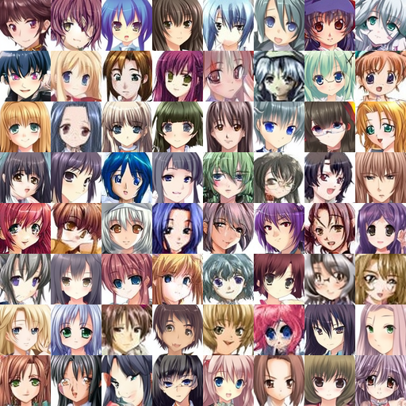
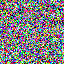
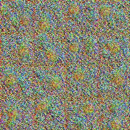
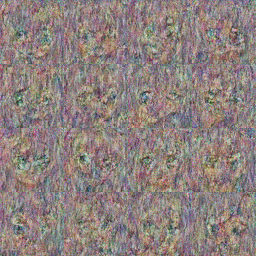
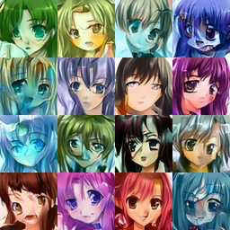
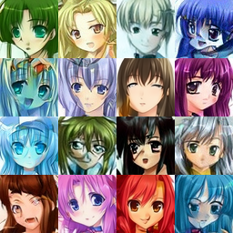
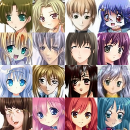
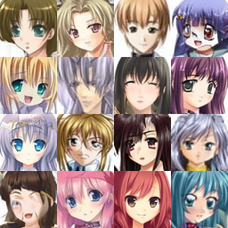

# PC3: difusión para rostros de anime

## Dónde está cada entregable

| Entregable                      | Archivo                                                                                                                                        |
| ------------------------------- | ---------------------------------------------------------------------------------------------------------------------------------------------- |
| Script del entrenamiento        | [`scripts/train.py`](scripts/train.py) (modelo en [`src/pc3/model.py`](src/pc3/model.py))                                                      |
| Scripts de resultados           | [`scripts/generate_images.py`](scripts/generate_images.py) (imágenes) y [`scripts/evaluate_quality.py`](scripts/evaluate_quality.py) (FID/KID) |
| Extensión SDEdit                | [`scripts/sdedit.py`](scripts/sdedit.py)                                                                                                       |
| Presentación                    | [`presentacion_web/`](presentacion_web/)                                                                                                       |
| Cambios y decisiones del modelo | [`docs/decisiones.md`](docs/decisiones.md)                                                                                                     |
| Notebook de Colab               | [`colab/generar_imagenes.ipynb`](colab/generar_imagenes.ipynb)                                                                                 |

Los pesos (`best.safetensors`) no están en el repo por su tamaño.

# Explicación de nuestro proyecto

Un modelo de difusión (DDPM) entrenado **desde cero** en PyTorch que convierte ruido en caras anime de 64×64. Con los mismos pesos se hace **SDEdit**: de una imagen a ruido y de vuelta a una cara nueva.

**Resultado:** 87 274 pasos en una RTX 4070 Ti (5.8 h) · **FID 10.10** · **KID 0.0039** sobre 4 152 imágenes de test.

## Evidencia

Todo sale de la corrida real `anime64_4070ti` y está en [`evidencia/`](evidencia/),
junto con los datos crudos: [`metrics.json`](evidencia/metrics.json) (FID/KID), [`history.csv`](evidencia/history.csv) (pérdida en cada paso) y [`run.json`](evidencia/run.json) (configuración y hardware).

**Rostros generados desde ruido puro**: las 64 primeras de las 5 000 que se usaron para el FID, sin elegir a mano (DDIM 50 pasos, pesos EMA).



**De ruido a rostro**, paso a paso:



**El modelo aprendiendo**: las mismas 16 semillas en distintos momentos del entrenamiento.

| Paso 0 | 1 000 | 5 000 | 15 000 | 40 000 | 87 274 (final) |
|---|---|---|---|---|---|
|  |  |  |  |  |  |


## 1. Ver la presentación

Requiere Node.js.

```bash
cd presentacion_web
npm install
npm run dev        # abrir http://127.0.0.1:5173 · tecla S = notas del orador
```

Los dos cuadros de la derecha (**Generar 4 imágenes** y **SDEdit**) funcionan en vivo si
en otra terminal se levanta el servidor con los pesos:

```bash
cd run
uv run serve_sdedit.py ruta/a/best.safetensors
```

## 2. Generar imágenes con los pesos

Solo requiere [uv](https://docs.astral.sh/uv/). Usa la GPU si existe; si no, la CPU.

```bash
cd run
uv run run_on_machine.py ruta/a/best.safetensors 16        # 16 caras → run/output/
uv run sdedit_proceso.py ruta/a/best.safetensors foto.jpg  # SDEdit → run/output_sdedit/
```

**Sin instalar nada:** abrir [`colab/generar_imagenes.ipynb`](colab/generar_imagenes.ipynb)
en Colab, activar la GPU y subir `best.safetensors`.

## 3. Reproducir el entrenamiento completo

Requiere uv y una GPU NVIDIA de 12 GB (CUDA 12.8).

```bash
uv sync --locked --extra cu128 --group dev
P=configs/entrenamiento/rtx4070ti_12gb.toml

uv run python scripts/prepare_dataset.py --download   # descarga y separa train/val/test
uv run python scripts/train.py --profile $P --run anime64_4070ti
uv run python scripts/generate_images.py --weights runs/anime64_4070ti/best.safetensors \
    --output reports/samples/anime64_4070ti
uv run python scripts/evaluate_quality.py --samples reports/samples/anime64_4070ti
```

- **Prueba rápida (minutos):** `--profile configs/entrenamiento/ensayo_rapido.toml`.
- **Otra GPU:** `uv run python scripts/calibrate.py --hours 6` genera su perfil.
- **Pausar y seguir:** Ctrl+C guarda; `--resume` continúa.
- **Ayuda de cada script:** `--help`.

`data/dataset_splits.json` define qué imágenes son de test. **No lo regeneres**, porque
invalidaría el FID. Las credenciales de Kaggle van en tu equipo, nunca en el repo.


## Estructura

```text
scripts/            un script por tarea (entrenar, generar, evaluar, SDEdit)
src/pc3/            código compartido: modelo, datos, configuración, muestreo
configs/            parámetros del proyecto y perfiles por GPU
run/                generar, SDEdit y servidor de la presentación (sin instalar el proyecto)
colab/              notebook de Colab
presentacion_web/   presentación (reveal.js, three.js, anime.js)
docs/decisiones.md  qué se entrenó, cómo se mide y por qué
evidencia/          imágenes, métricas e historial de la corrida real
tests/              pruebas: uv run pytest
old/                versión anterior, ya no se usa
```

## Licencia

El código está bajo licencia [MIT](LICENSE). La licencia del dataset no da derechos sobre
las imágenes generadas ni sobre las fotos usadas en SDEdit.
